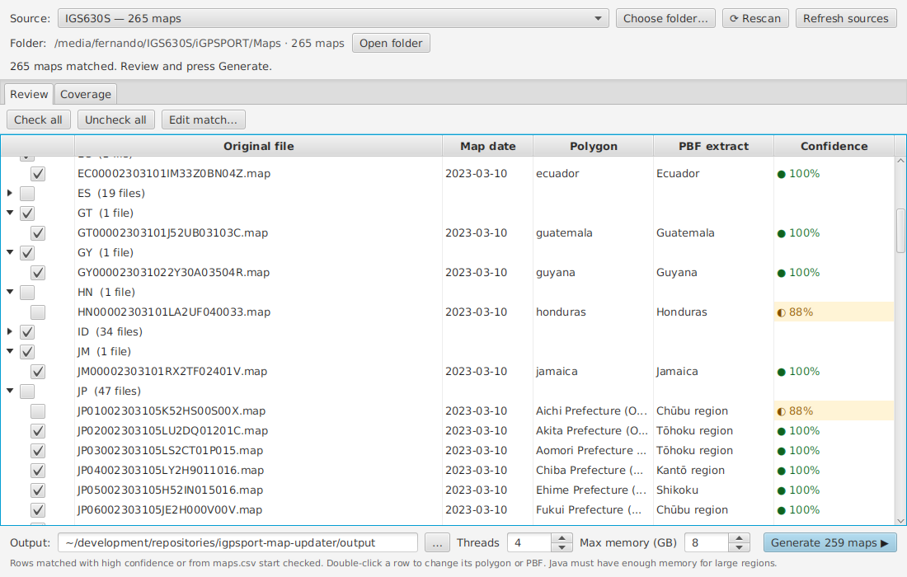
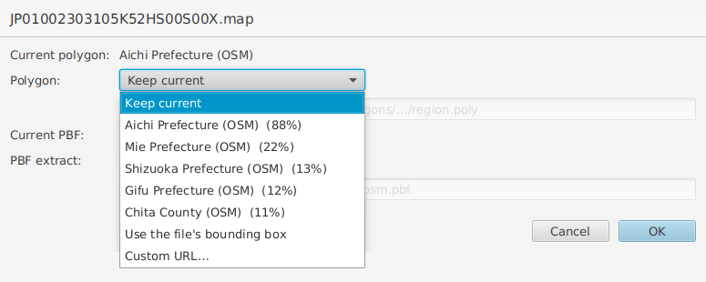
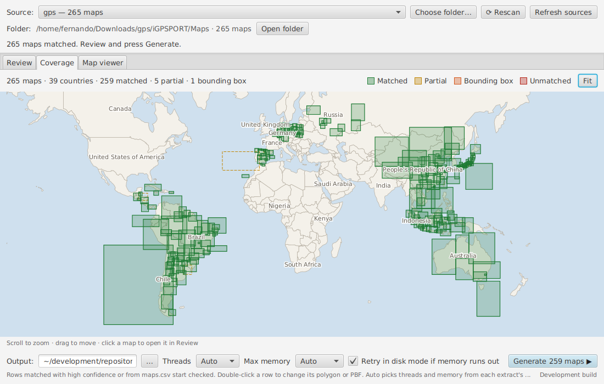
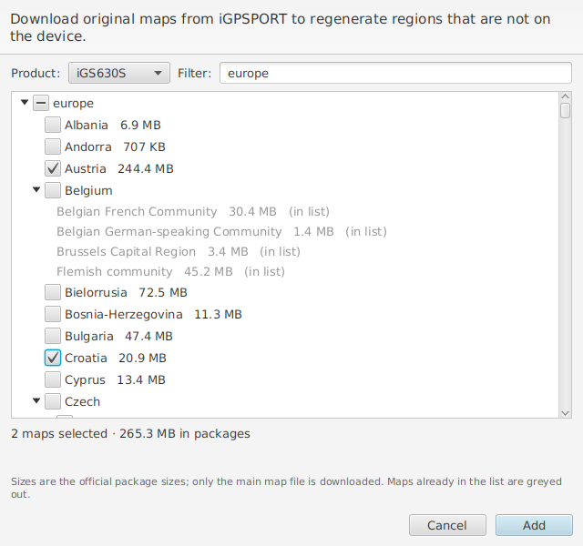
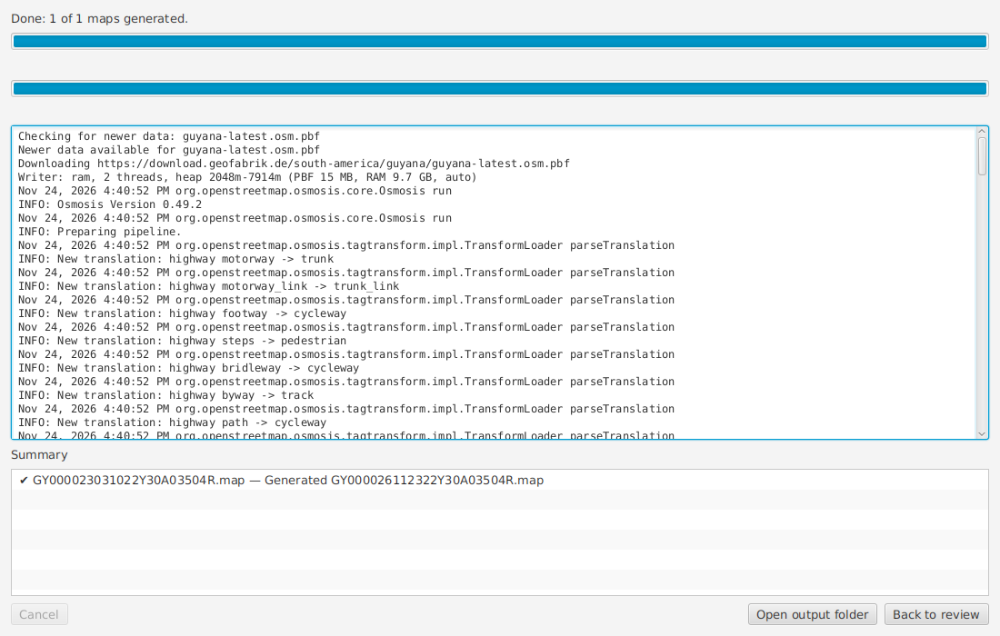
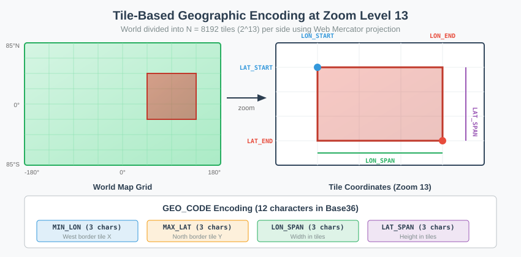
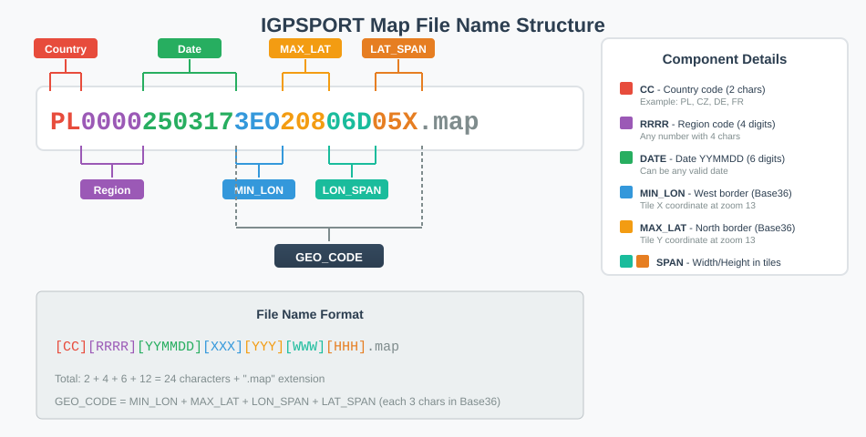
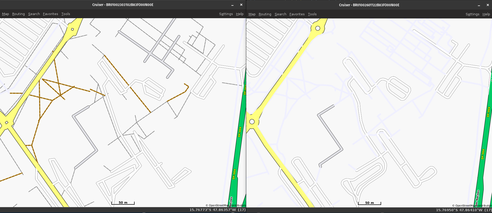

# IGPSPORT Map Updater

A desktop app that regenerates the offline maps of IGPSPORT cycling computers from current OpenStreetMap data. It finds the original maps on your device, works out the matching OpenStreetMap region for each one, and builds new Mapsforge `.map` files with the file names IGPSPORT devices expect.

## Features

- **Finds your maps**: detects the connected device (or a folder of original maps) and matches every map to an OpenStreetMap region, with a confidence score you can review and override.
- **Adds maps you don't have**: downloads original maps from iGPSPORT's official catalog for your device, so you can regenerate regions that aren't on it.
- **Tunes itself**: picks the Mapsforge writer mode, threads and memory from each extract's size and your installed RAM, and retries in disk mode if memory runs out.
- **Shows coverage**: every map on a world map, coloured by match status.
- **Keeps IGPSPORT's file names**: output files are named the way the device expects, with the date of the OpenStreetMap data.

## Supported Products

- BiNavi
- BiNavi Air
- iGS800
- BSC500
- iGS630
- iGS630S
- BSC300T
- BSC300

BiNavi Ultra isn't supported: its maps use another format (`.imap`). If you connect a device the app can't update, it tells you why.

Official support/download page: https://www.igpsport.com/en/support/product

## Important Notes

⚠️ **Use At Your Own Risk**: I am not responsible for broken devices.

⚠️ **Back Up Your Maps**: Before copying new maps to the device, back up the existing ones (for example into a `Backup/` folder on your computer) so you can revert.

⚠️ **Free Up Space**: The new maps are larger than the originals (more detail, more tags). Remove the old maps from the device before copying the new ones.

⚠️ **Processing Time**: Generating maps for a whole country can take hours, depending on its size and your computer. Large regions need several GB of memory.

## Install

Download the file for your system from the [latest release](https://github.com/fernandoglatz/igpsport-map-updater/releases/latest):

| System | Installer | Portable (no install) |
|--------|-----------|-----------------------|
| Windows x64 | `.msi` | `.zip` |
| Linux x64 | `.deb` | `.tar.gz` |
| macOS Apple Silicon | `.dmg` | `.tar.gz` |

Java is bundled, so nothing else is needed. The macOS build isn't signed: on first launch, right-click the app and choose **Open**.

## How to Use

1. **Connect the device over USB**, or keep a folder with copies of its original `.map` files. The app scans connected devices automatically; use **Choose folder…** for a folder. The folder the maps were found in is shown under the source. Subfolders named `Backup` are skipped, so old copies kept on the device don't show up.
2. **Review the matches.** Each map appears with its date (from the file name), the polygon and the OpenStreetMap extract (PBF) the app picked, plus a confidence score. **Check all** / **Uncheck all** select every matched map at once:
   - `● 100%` / `● from maps.csv`: a confident match, checked by default.
   - `◐ 88%`: a partial match, unchecked and highlighted. Double-click the row to choose another candidate or type URLs.
   - `◌ bounding box`: no polygon matched; the map is cut as a rectangle around the original's area. It works, but it also contains a bit of the neighbouring regions.

   

   *The 265 maps of an iGS630S, grouped by country. German states match their Geofabrik extracts; for one map (DE06) no polygon fit, so it falls back to a bounding box and starts unchecked.*

   

   *Double-clicking a row lists the alternatives with their scores, plus the bounding-box and custom-URL options.*

   The **Coverage** tab shows every map on a world map, coloured by status, with a count of maps and countries. Scroll to zoom, drag to move, hover a map for its details, and click it to open its row in **Review**. The background map is built into the app ([Natural Earth](https://www.naturalearthdata.com/), public domain), so it works offline.

   

3. **Add maps that aren't on your device** (optional). **Add maps…** opens iGPSPORT's official map catalog for your device. **Product** is preselected from the connected device's name (or the last one you used); filter by name and check the regions you want. Regions already in the list are greyed out. Only the main `.map` file is downloaded out of each official package, not its routing or contour files. The new maps are matched and added to the list like the device's own. It also works with no device connected.

   

   *The iGS630S catalog, preselected from the connected device. Regions the device already has are greyed out.*

   Downloads are kept in the app's `originals/` folder, so adding the same region again is instant.

4. **Press Generate.** Downloads, conversion and renaming run one map at a time, with progress, MB/s and a log. **Cancel** stops cleanly.

   **Threads** and **Max memory** default to **Auto**: each map is written with the fast in-memory writer, using 2 threads for extracts up to 350 MB and 1 thread above that, with the memory limit set to 80% of your installed RAM. Pick fixed values to override. **Retry in disk mode if memory runs out** (on by default) reruns a map with the slower disk-based writer when the in-memory one fails. Either way, a warning lists the maps where memory mode failed when the run ends.

   

   *Regenerating Guyana from the iGS630S: Auto picked the in-memory writer with 2 threads and a heap of up to 80% of the machine's 9.7 GB.*

5. **Copy the files** from the output folder to the device's `iGPSPORT/Maps/` folder, replacing the old ones.

Confirmed matches are saved to `maps.csv`, so the next run starts from them.

### How matching works

Each original file name contains a GEOCODE (see [below](#igpsport-filename-structure)) that describes the map's area. The app decodes it and compares that area with polygons from three sources, in this order:

1. [openstreetmap.fr polygons](https://download.openstreetmap.fr/polygons/): countries and their regions/states.
2. [Geofabrik](https://download.geofabrik.de/) region outlines: whole countries and large regions.
3. OpenStreetMap administrative boundaries (found with the [Overpass API](https://overpass-api.de/), polygons from [polygons.openstreetmap.fr](https://polygons.openstreetmap.fr/)): used only when the first two don't match well, e.g. Japanese prefectures.

The PBF is the smallest Geofabrik extract that covers the chosen polygon. Source listings are cached for 7 days; **Refresh sources** clears the cache.

## Tag Configuration

Two XML files control which OpenStreetMap tags end up in the maps. They're built into the app; a copy of either file in the working folder overrides the built-in one.

### Supported Tags ([tag-igpsport.xml](tag-igpsport.xml))

The following **21 tags** are directly supported by IGPSPORT devices:

| Category | Tags | Zoom Level |
|----------|------|------------|
| **Major Roads** | primary, primary_link, secondary, secondary_link, trunk, trunk_link, tertiary, tertiary_link | 13 |
| **Minor Roads** | cycleway, living_street, pedestrian, residential, road, service, track, unclassified | 14 |
| **Natural** | coastline, water | 13 |
| **Waterways** | canal, dam, drain, river, stream | 14 |

### Tag Transformations ([tag-igpsport-transform.xml](tag-igpsport-transform.xml))

The following **12 transformations** convert unsupported OSM tags to device-compatible equivalents:

| Unsupported Tag | Transformed To | Description |
|-----------------|----------------|-------------|
| `highway=motorway` | `highway=trunk` | Major highways |
| `highway=motorway_link` | `highway=trunk_link` | Highway ramps |
| `highway=footway` | `highway=cycleway` | Pedestrian paths |
| `highway=path` | `highway=cycleway` | Generic paths |
| `highway=bridleway` | `highway=cycleway` | Horse trails |
| `highway=sidewalk` | `highway=cycleway` | Sidewalks |
| `highway=steps` | `highway=pedestrian` | Stairs |
| `highway=byway` | `highway=track` | Rural byways |
| `highway=bus_guideway` | `highway=road` | Guided bus routes |
| `highway=construction` | `highway=road` | Roads under construction |
| `highway=raceway` | `highway=road` | Racing circuits |
| `highway=services` | `highway=service` | Service areas |

This means the maps effectively support **33 highway types** (21 native + 12 transformed).

See the [Mapsforge tag-mapping reference](https://github.com/mapsforge/mapsforge/blob/master/mapsforge-map-writer/src/main/config/tag-mapping.xml) for all available OpenStreetMap tags.

## maps.csv

`maps.csv` stores confirmed matches, one row per map region:

| Column | Description | Example |
|--------|-------------|---------|
| **Original filename** | The original IGPSPORT map file | `BR01002303102B83FO00N00E.map` |
| **OSM BPF URL** | OpenStreetMap PBF extract | `https://download.geofabrik.de/south-america/brazil-latest.osm.pbf` |
| **Poly URL** | Polygon boundary file | `https://download.openstreetmap.fr/polygons/south-america/brazil/central-west/distrito-federal.poly` |

Rows are matched by country, region code and GEOCODE, ignoring the date, so a newer or older version of the same map reuses its row. You can edit the file by hand; the app picks up the changes on the next run.

## IGPSPORT Filename Structure

The map files follow a naming convention required by IGPSPORT devices:

```
[CC][RRRR][YYMMDD][GEOCODE].map
```

| Component | Length | Description | Example |
|-----------|--------|-------------|---------|
| **CC** | 2 chars | Country code | `BR`, `PL`, `US` |
| **RRRR** | 4 digits | Region/Product code | `0100`, `0200` |
| **YYMMDD** | 6 digits | Date (Year, Month, Day) | `250317` = March 17, 2025 |
| **GEOCODE** | 12 chars | Geographic boundary encoding | `2B83FO00N00E` |

Generated maps keep the country and region code of the original, use the date of the OpenStreetMap data, and get a GEOCODE computed from the new map's bounding box.

### GEOCODE Breakdown (12 characters, Base36 encoding)

The GEOCODE consists of 4 parts, each 3 characters in Base36:

1. **MIN_LON** (XXX): Western boundary - minimum longitude as tile X coordinate at zoom 13
2. **MAX_LAT** (YYY): Northern boundary - maximum latitude as tile Y coordinate at zoom 13
3. **LON_SPAN** (WWW): Width in tiles - 1 (horizontal span)
4. **LAT_SPAN** (HHH): Height in tiles - 1 (vertical span)



### Example

**Filename**: `BR01002303102B83FO00N00E.map`

- **BR**: Brazil
- **0100**: Region code 0100
- **230310**: March 10, 2023
- **2B8**: MIN_LON (tile X at zoom 13)
- **3FO**: MAX_LAT (tile Y at zoom 13)
- **00N**: LON_SPAN (width in tiles)
- **00E**: LAT_SPAN (height in tiles)



## Viewing and Comparing Maps

[Cruiser](https://wiki.openstreetmap.org/wiki/Cruiser) is a cross-platform map viewer that opens Mapsforge `.map` files. Use it to check generated maps before copying them to the device, or to compare them with the originals.

Below is a comparison between an original IGPSPORT map (left) and a generated one (right):



*Left: Original map (2023) | Right: Enhanced map (2026)*

## Troubleshooting

### The device isn't found
- Make sure it's connected as a USB drive and shows up in your file manager, then press **⟳ Rescan**.
- In a virtual machine, pass the USB device through to the VM.
- Or copy the original maps to a folder and use **Choose folder…**.
- If the app says the **connected device is not supported**, it found an iGPSPORT device without maps it can update: either a model with a newer map format (`.imap` files, e.g. BiNavi Ultra), or a supported model with no `.map` files on it (use **Add maps…** to download the official ones).

### Out of memory
With **Max memory** on **Auto**, the app already uses up to 80% of your RAM. If memory mode still fails, the map is retried in disk mode (slower, but it needs much less memory) and the run ends with a warning listing those maps. If you turned **Retry in disk mode if memory runs out** off, turn it back on.

### "Overpass is busy"
The OpenStreetMap boundary service is overloaded now and then. The app retries automatically; if it still fails, press **Refresh sources** later.

### Download failures
Check your internet connection. If a source URL changed, double-click the row and pick another candidate or type the new URL.

## Technical Details

### Processing Pipeline

For each confirmed map:

1. **Download** the PBF extract (reused while it's current; interrupted downloads resume) and the polygon.
2. **Run osmosis** with the Mapsforge writer plugin:
   `--read-pbf-fast` → `--bounding-polygon` → `--tag-transform` → `--mapfile-writer type=ram zoom-interval-conf=13,13,13,14,14,14` (`type=hd` for the disk-mode retry)
3. **Rename** the result: read the map's bounding box, compute the GEOCODE, and apply the IGPSPORT file name.

### Map Features Included

- **Roads**: highways, paths, tracks (with tag transformation for unsupported types)
- **Waterways**: rivers, streams, canals, dams, drains
- **Natural features**: water bodies, coastlines

Everything else (buildings, POIs, amenities, etc.) is left out to keep files small and focused on navigation.

## Development

The app is a Java 17 + JavaFX Maven project in [app/](app/). Requires JDK 17+ and Maven.

```bash
mvn -f app/pom.xml javafx:run                                                             # run from source
mvn -f app/pom.xml test                                                                   # unit tests
mvn -f app/pom.xml test -Dsurefire.groups=integration -Dsurefire.excludedGroups=           # real osmosis run
```

When run from this repository, the app uses the repository's `maps.csv`, `download/`, `output/` and `cache/` folders. When installed, it keeps its data in the user data folder (`~/.local/share/igpsport-map-updater` on Linux).

### Build an installer

Build on the target OS (jpackage can't cross-build). Files are written to `app/target/release/`:

```bash
app/package.sh                                # Linux .deb; macOS .dmg
app/package.sh --type deb --type app-image    # several types; app-image is archived as .tar.gz
```

```powershell
.\app\package.ps1                             # Windows .msi (needs the WiX Toolset 3)
.\app\package.ps1 -Type msi,app-image         # app-image is archived as .zip
```

The app icon is drawn by `app/packaging/make_icon.py` (Python with Pillow). It writes the window icons to `app/src/main/resources/ui/` and the installer icons (`icon.png`, `icon.ico`, `icon.icns`) to `app/packaging/`. Run it again after changing the drawing.

## License

This project is licensed under the **Apache License 2.0** - see the [LICENSE](LICENSE) file for details.

### Dependencies and Data
- **Osmosis**: LGPL ([GitHub](https://github.com/openstreetmap/osmosis))
- **Mapsforge**: LGPL ([GitHub](https://github.com/mapsforge/mapsforge))
- **OpenStreetMap Data**: ODbL ([License](https://www.openstreetmap.org/copyright))
- **Natural Earth** (coverage base map): public domain ([Terms of use](https://www.naturalearthdata.com/about/terms-of-use/))

## References

- [Reddit thread](https://www.reddit.com/r/cycling/comments/1khm2ou/newcustom_maps_on_igpsport_bsc300t_630s) shared by [u/povlhp](https://www.reddit.com/user/povlhp/)
- [Original project](https://github.com/tm-cms/MapsforgeMapName) by [tm-cms](https://github.com/tm-cms)
- [OpenStreetMap](https://www.openstreetmap.org/)
- [OpenStreetMap France](https://download.openstreetmap.fr/) - Polygon files
- [Geofabrik Downloads](https://download.geofabrik.de/) - OSM PBF files
- [Overpass API](https://overpass-api.de/) - OpenStreetMap boundary lookup
- [Osmosis Documentation](https://wiki.openstreetmap.org/wiki/Osmosis)
- [Mapsforge](https://github.com/mapsforge/mapsforge)
- [Cruiser Map Viewer](https://wiki.openstreetmap.org/wiki/Cruiser)
- [Natural Earth](https://www.naturalearthdata.com/) - Coverage base map
